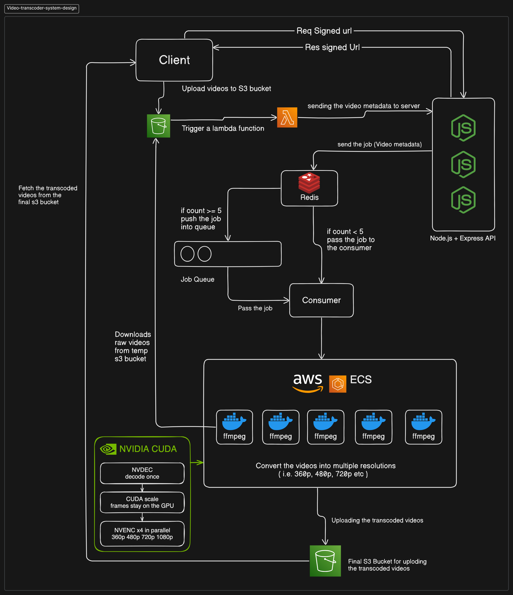

# VidFlow - Video Transcoding System

This project implements a distributed video transcoding system with a leaky bucket rate-limiting mechanism using Node.js, AWS services, Redis, and ffmpeg, aimed at automatically generating multiple resolutions of uploaded videos. It enhances accessibility and optimizes viewing experiences by providing users with options to preview and download videos in various resolutions.

**Powered by NVIDIA CUDA:** the pipeline decodes each video once (NVDEC), scales it on the GPU (CUDA) and encodes all four resolutions in parallel (NVENC), with an automatic CPU fallback.

**Orchestrated on AWS:** the whole job lifecycle runs on AWS managed services (S3, Lambda, ECS, API Gateway, CloudWatch) and is defined as code with Terraform.

## Project Demo

## Table of Contents
- [Architecture](#architecture)
- [NVIDIA CUDA Acceleration](#nvidia-cuda-acceleration)
- [Tech Stack](#tech-stack)
- [Setup Instructions](#setup-instructions)
- [How It Works](#how-it-works)
- [Environment Variables](#environment-variables)
- [Endpoints](#endpoints)
- [Improvements](#improvements)

## Architecture

The original diagram (without the CUDA stage) is still available at [assets/video-transcoder-system-design.png](./assets/video-transcoder-system-design.png).

## NVIDIA CUDA Acceleration

- **Decode once, encode four in parallel**: the source is decoded a single time and 1080p, 720p, 480p and 360p are produced at the same moment.
- **GPU pipeline**: NVDEC (decode) → CUDA scaling → NVENC (encode), so frames stay in GPU memory.
- **CPU fallback**: if a file cannot be handled on the GPU, the job runs on CPU.
- **Scale to zero**: GPU workers run on ECS (EC2) and scale from zero when a job arrives and back to zero when idle.

See [docs/gpu-migration.md](docs/gpu-migration.md) and [docs/performance.md](docs/performance.md).

## Technologies Used

- **AWS Services**: S3, Lambda, EventBridge, ECS (Fargate and EC2 GPU), API Gateway
- **Acceleration**: NVIDIA CUDA (NVDEC, NVENC)
- **Frontend**: Next.js (deployed on Vercel)
- **Backend**: Node.js (with Express.js), Google OAuth
- **Database**: MongoDB, Redis
- **Docker**
- **Infrastructure as Code**: Terraform

## Project Structure

The project is organized into several components:

- **ecs-task**: Manages the transcoding process by spinning up Docker containers on ECS.
- **upload-trigger-api**: AWS Lambda function triggered by S3 events, initiates video transcoding tasks.
- **video-transcoder-client**: Next.js frontend for uploading videos, previewing transcoded videos, and downloading transcoded files.
- **server**: Main Express server (runs on ECS Fargate), handles Google sign-in, video transcoding job queue management, rate limiting, and webhook calls.
- **infra**: Terraform for the whole AWS stack.

## Features

- Automatically transcodes uploaded videos into multiple resolutions (360p, 480p, 720p, 1080p).
- Rate limiting to ensure a configurable maximum of concurrent video transcoding jobs.
- NVIDIA CUDA accelerated transcoding (NVDEC, CUDA scaling, NVENC) with an automatic CPU fallback.
- Google sign-in; every user only sees their own videos.
- Integration with MongoDB for storing video metadata and status.
- Utilizes signed URLs for secure uploads and downloads from S3.
- Leverages AWS EventBridge for triggering transcoding tasks upon video upload events.

## Key Features
- **AWS Integration**: Utilizes AWS services like S3 for storage, Lambda for serverless computing, EventBridge for event-driven architecture, ECS for container orchestration, and MongoDB for database management.
- **Dockerized Video Transcoding**: Leverages Docker containers for efficient and scalable video transcoding tasks.
- **Event-Driven Architecture**: Initiates video transcoding tasks automatically upon video upload using S3 events and triggers further processing using EventBridge and Lambda functions.
- **Rate Limiting**: Implements rate limiting using a leaky bucket strategy to ensure efficient resource utilization and prevent overload.
- **Queue Management with Redis**: Utilizes Redis for queuing video transcoding jobs, ensuring efficient task management and scalability.
- **Webhook Notifications**: Sends webhook notifications upon completion or failure of video transcoding tasks, facilitating real-time updates.
- **Next.js Frontend**: Provides a user-friendly frontend interface for seamless video upload, preview, and download functionalities.

## Getting Started

To get started with the project, follow these steps:

1. Clone the repository: `git clone <repository-url>`
2. Install dependencies for each component (frontend, backend, ECS task).
3. Configure environment variables for AWS services, MongoDB, and other settings.
4. Deploy the backend components (Lambda functions, ECS task) using Terraform (`infra/`) and the scripts in `scripts/` (see [docs/go-live.md](docs/go-live.md)).
5. Launch the frontend application and start uploading and transcoding videos.

## How to Run
1. **Setup AWS Services**: Configure AWS S3 buckets, Lambda functions, ECS clusters, and EventBridge rules as per the provided configuration.
2. **Deploy Backend**: Deploy the backend with Terraform and `scripts/deploy-api.sh`.
3. **Build and Deploy Frontend**: Build the Next.js frontend and deploy it to Vercel (see [docs/vercel.md](docs/vercel.md)).
4. **Configure Environment Variables**: Set up environment variables for AWS credentials, S3 bucket names, webhook URLs, etc.
5. **Run the System**: Start the system and verify functionality by uploading videos, monitoring transcoding tasks, and accessing transcoded files.

## Usage

- Upload videos through the frontend interface.
- Preview transcoded videos in various resolutions.
- Download transcoded files individually or as a zip archive.

---

**If you find this project useful, please consider giving it a ⭐ on GitHub!**

