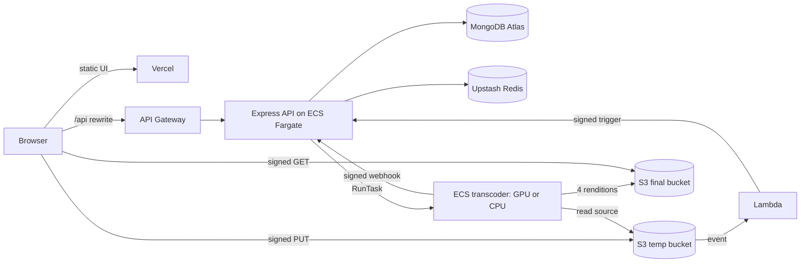

# VidFlow

Upload a video, get 1080p, 720p, 480p and 360p versions back in about a minute, with live progress, in-browser preview and one-click downloads.

**Live:** https://vidflow-transcoder.vercel.app (sign in with Google)

## Why it is fast: built on NVIDIA CUDA

- **Decode once, encode four in parallel.** The source is decoded a single time and all four resolutions are produced at the same moment.
- **Frames stay on the GPU.** The GPU path is NVDEC (decode) → CUDA scaling → NVENC (encode, `h264_nvenc`), with no copies back to system memory.
- **Safe CPU fallback.** If a file cannot be handled on the GPU, the job transparently runs on CPU (libx264, tuned `veryfast`/CRF 19, about 2× faster than the defaults).
- **Elastic.** GPU workers (ECS on EC2, `g4dn`) scale from zero when a job arrives and back to zero when idle.

Which path runs is controlled by `TRANSCODE_MODE` (`gpu` | `cpu`). The site reads the current mode from `/api/v1/video/config` and words its claims accordingly. The GPU path needs an AWS G/VT vCPU quota; until that is granted the deployment runs the CPU path. Details and benchmarks: [docs/gpu-migration.md](docs/gpu-migration.md), [docs/performance.md](docs/performance.md).

## Architecture



Everything in AWS is defined in Terraform ([infra/](infra)).

## Repository layout

| Path | What it is |
|---|---|
| `video-transcoder-client/` | Next.js 14 static UI (Tailwind, framer-motion) deployed on Vercel |
| `server/` | Express API: Google OAuth, owner-scoped video routes, limits, retention, job webhooks |
| `ecs-task/` | The transcoder container (ffmpeg; GPU and CPU images) |
| `upload-trigger-api/` | Lambda that turns an S3 upload event into a job |
| `infra/` | Terraform for the whole AWS stack (`infra/bootstrap/` is the one-time admin step) |
| `scripts/` | Deploy, secrets, verification and smoke-test scripts |
| `docs/` | [go-live](docs/go-live.md) · [vercel](docs/vercel.md) · [local-testing](docs/local-testing.md) · [gpu-migration](docs/gpu-migration.md) · [performance](docs/performance.md) |

## Security model

- Google sign-in (Passport, server-side sessions, helmet CSP). `ALLOW_ANYONE=true` lets any Google account in; otherwise an email allowlist applies and fails closed.
- Videos are private to their owner; uploads and downloads use short-lived signed S3 URLs; per-job HMAC tokens secure the worker webhooks; the S3 trigger needs a shared secret.
- Per-user and global daily upload limits, a size cap, automatic retention cleanup, and delete-anytime.
- No credentials in the repo: AWS access uses IAM roles; secrets live in SSM Parameter Store.

## Run it locally

```bash
cd server && npm install && npm run dev            # API on :8000 (AUTH_DISABLED=true skips Google login locally)
cd video-transcoder-client && npm install && npm run dev   # UI on :3000
```

Testing against real AWS from your laptop: [docs/local-testing.md](docs/local-testing.md). Deploying: [docs/go-live.md](docs/go-live.md) and [docs/vercel.md](docs/vercel.md).

```bash
cd server && npm test                    # API tests
node scripts/check-live.js               # smoke-test the deployed site
```
